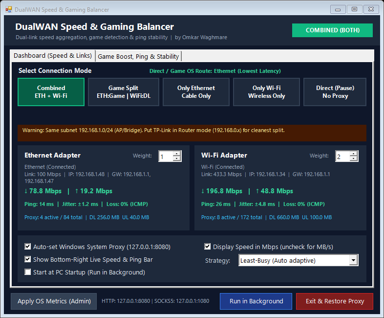
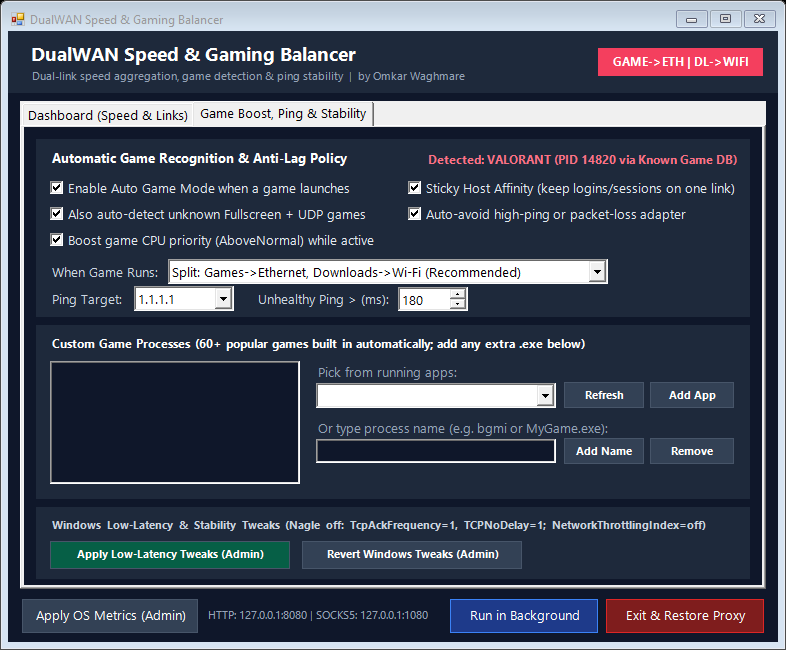

# DualWAN Speed & Gaming Balancer

[-0078D6?style=flat-square&logo=windows)](https://github.com/omkarwaghmare-1/DualWAN-Speed-Gaming-Balancer/releases/latest)
[-512BD4?style=flat-square)](https://github.com/omkarwaghmare-1/DualWAN-Speed-Gaming-Balancer)
[](LICENSE)
[](https://github.com/omkarwaghmare-1)
[](https://omkarwaghmare-1.github.io/DualWAN-Speed-Gaming-Balancer/)

An open-source Windows Dual-WAN manager and load-balancing suite designed for PCs connected to **both Ethernet and Wi-Fi simultaneously** — featuring a native desktop GUI + floating bottom-right Speed & Ping Bar (`DualWanBalancer.exe`), automatic game detection with **Game Split** traffic isolation, real-time per-link latency monitoring, and optional PowerShell/Node.js CLI tools.

> **Project Website & UI Showcase:** https://omkarwaghmare-1.github.io/DualWAN-Speed-Gaming-Balancer/  
> **Download Windows App:** [DualWanBalancer.exe (Latest Release)](https://github.com/omkarwaghmare-1/DualWAN-Speed-Gaming-Balancer/releases/latest/download/DualWanBalancer.exe)

---

## Screenshots

### Main Dashboard & Mode Switcher


### Game Boost, Live Ping & Windows Latency Tweaks


### Floating Bottom-Right Live Speed & Ping Bar


---

## Key Features

### 1. Native Desktop App (`DualWanBalancer.exe`)
- **Zero external dependencies:** Pure C# WinForms compiled directly with the built-in Windows `.NET Framework 4.x` (`csc.exe`) into a single ~125 KB executable.
- **Floating Bottom-Right Live Speed & Ping Bar:** Always-on compact HUD docked above the Windows taskbar showing real-time **Download (`↓`)**, **Upload (`↑`)**, **Ping (`ms`)**, per-adapter `ETH` / `WIFI` breakdown, and active mode badge (`BOTH`, `SPLIT`, `ETH`, `WIFI`, `GAME`, `DIRECT`).
- **System Tray + Single-Instance Activation:** Runs cleanly in the background (`--background`), supports one-click switching from the tray context menu, and pops open the existing window when re-launched from the Desktop or Taskbar.
- **5 Connection Modes:**
  - **Combined (`ETH + Wi-Fi`):** Distributes parallel HTTP/HTTPS/SOCKS5 connections across both Ethernet and Wi-Fi with configurable weights and automatic failover.
  - **Game Split (`ETH:Game | WiFi:DL`):** Isolates proxy/browser/download traffic strictly onto Wi-Fi while Windows OS keeps direct game sockets on low-latency Ethernet.
  - **Only Ethernet:** Routes proxy traffic strictly through Ethernet.
  - **Only Wi-Fi:** Routes proxy traffic strictly through Wi-Fi.
  - **Direct (Pause):** Stops the local proxy and cleanly restores original Windows System Proxy settings.
- **Automatic Windows System Proxy Management:** Sets `HKCU` Internet Settings (`127.0.0.1:8080`) with WinINet refresh and automatically backs up & restores your previous proxy settings on exit, pause, or Windows shutdown (`SessionEnding`).
- **PC Startup Integration:** First-launch prompt + toggle for `HKCU\Software\Microsoft\Windows\CurrentVersion\Run` (`--background`).

### 2. Game Recognition, Ping Monitoring & Stability
- **Real-Time Source-Bound Ping, Jitter & Loss (`LatencyMonitor.cs`):** Independently probes both Ethernet and Wi-Fi every 3 seconds via Win32 `IcmpSendEcho2Ex` (with automatic `TCP:443` fallback if ICMP is blocked).
- **Automatic Game Detection (`GameDetector.cs`):**
  - 55+ built-in PC games and emulators (VALORANT, CS2, Fortnite, Apex Legends, PUBG, GTA V / FiveM, Call of Duty, League of Legends, Dota 2, Roblox, BGMI, Minecraft, etc.).
  - Custom process picker (add from currently running apps or by `.exe` name).
  - Optional heuristic detection for unlisted fullscreen games holding active UDP sockets (`GetExtendedUdpTable`).
- **Live Direct/Game OS Route Verification (`GetBestInterface`):** Shows in real time whether Windows is routing direct game sockets via `Ethernet` or `Wi-Fi`, with a one-click **`Apply OS Metrics (Admin)`** button setting Ethernet (IPv4 + IPv6) Metric `10` and Wi-Fi Metric `50`.
- **Stability Protections (`DualWanProxyEngine.cs`):**
  - **Sticky Host Affinity:** Pins each domain/host to one healthy uplink (5-minute TTL) to prevent mid-session disconnects on logins and game launchers.
  - **Ping/Loss Auto-Failover & `Lowest Ping` Strategy:** Automatically places high-latency or packet-loss links into cooldown and routes connections to the healthier adapter.
- **Reversible Windows Low-Latency Tweaks (`NetworkOptimizer.cs`):** Optional one-click Administrator tweaks to disable Nagle's algorithm (`TcpAckFrequency = 1`, `TCPNoDelay = 1`) and Windows multimedia throttling (`NetworkThrottlingIndex = 0xFFFFFFFF`, `SystemResponsiveness = 0`), with JSON backup and 1-click revert.

### 3. CLI & PowerShell Scripts (Optional)
- `dual-wan-manager.ps1` — PowerShell diagnostic & controller (`Status`, `Proxy`, `EqualMetrics`, `Restore`).
- `dual-wan-proxy.js` — Standalone zero-dependency Node.js HTTP/HTTPS `CONNECT` + SOCKS5 load-balancing proxy.

---

## How Dual-WAN Routing Works (Architecture)

```text
                       ┌───────────────────────────────────────┐
                       │         Applications on Windows       │
                       └──────────┬──────────────────┬─────────┘
                                  │                  │
         Browsers / IDM / Proxy   │                  │  Games / Direct UDP & TCP
        (127.0.0.1:8080 / :1080)  ▼                  ▼  (Windows Routing Table)
                   ┌──────────────────────┐   ┌──────────────────────────┐
                   │ DualWanProxyEngine   │   │ OS Default Route Metric  │
                   │ (Strong-Host Bind)   │   │ Ethernet=10 < Wi-Fi=50   │
                   └─────┬──────────┬─────┘   └────────────┬─────────────┘
                         │          │                      │
      Combined / Split   ▼          ▼                      ▼
                  Wi-Fi IP          Ethernet IP ◄──────────┘
             (192.168.1.x)          (192.168.0.x or 192.168.1.x)
```

### Important Networking Realities
1. **Multi-connection vs. single-stream speeds:** Windows does not natively bond Ethernet + Wi-Fi at the packet level into one faster single TCP connection. Socket-level load balancing speeds up **multi-connection traffic** (modern web browsing, multi-part downloads such as IDM/`aria2c`, torrents, and parallel uploads). True single-stream bonding requires a packet-bonding VPN (such as Speedify or OpenMPTCProuter with a VPS).
2. **Single-Router vs. Dual-ISP setups:**
   - If Ethernet and Wi-Fi connect to **two separate ISPs** (or one router + mobile hotspot), combined throughput scales up to the sum of both links.
   - If both connect to the **same Main Router** (e.g., `Main Router -> 100 Mbps TP-Link -> Ethernet` and `Main Router -> Wi-Fi`), combined speed cannot exceed your Main Router's ISP plan — it helps specifically when your ISP speed is **> 100 Mbps** and the intermediate Ethernet router/cable is capped at 100 Mbps.
3. **Separate Subnets Recommended:** If using a secondary router before Ethernet, configure it in **Router mode** (Main Router LAN → Secondary Router WAN) with its own LAN subnet (e.g., `192.168.0.1/24` vs. Main Router `192.168.1.1/24`) to avoid same-subnet ARP conflicts.

---

## Repository Structure

```text
.
├── DualWanApp/
│   ├── AppConfig.cs            # JSON settings persistence & v1->v2 migration
│   ├── AssemblyInfo.cs         # Embedded Windows executable metadata & author
│   ├── DualWanProxyEngine.cs   # Async HTTP/HTTPS CONNECT & SOCKS5 balancer
│   ├── GameDetector.cs         # Built-in game DB, custom list, Fullscreen+UDP heuristic
│   ├── IconGenerator.cs        # Dynamic tray/window icons per active mode
│   ├── LatencyMonitor.cs       # Source-bound ICMP (IcmpSendEcho2Ex) + TCP:443 RTT probes
│   ├── MainForm.cs             # Tabbed dark-mode Dashboard & Game Boost UI
│   ├── NetworkDiscovery.cs     # Adapter stats, GetBestInterface, Startup & Proxy registry
│   ├── NetworkOptimizer.cs     # Reversible Nagle / NetworkThrottlingIndex tweaks
│   ├── Program.cs              # Single-instance coordinator, TrayIcon & Game Mode engine
│   ├── SpeedBarForm.cs         # Floating bottom-right live speed & ping bar
│   └── build.ps1               # Compiles DualWanBalancer.exe via built-in csc.exe
├── docs/
│   ├── assets/                 # Rendered Windows UI screenshots
│   └── index.html              # GitHub Pages landing UI
├── dual-wan-manager.ps1        # PowerShell CLI status, metrics & proxy launcher
├── dual-wan-proxy.js           # Standalone zero-dependency Node.js proxy
├── .github/
│   ├── ISSUE_TEMPLATE/         # Bug report & feature request templates
│   └── workflows/build.yml     # GitHub Actions CI build, artifact & release workflow
├── CHANGELOG.md
├── CONTRIBUTING.md
├── LICENSE
└── README.md
```

---

## Getting Started

### Option 1: Download Prebuilt Binary (Fastest)
1. Download **`DualWanBalancer.exe`** from the [Latest GitHub Release](https://github.com/omkarwaghmare-1/DualWAN-Speed-Gaming-Balancer/releases/latest/download/DualWanBalancer.exe).
2. Double-click `DualWanBalancer.exe` (Windows 10 / 11 x64 — no installation or extra runtimes needed).

### Option 2: Build from Source (`DualWanBalancer.exe`)

**Requirements:** Windows 10 or Windows 11 (x64) with built-in `.NET Framework 4.x` (`C:\Windows\Microsoft.NET\Framework64\v4.0.30319\csc.exe`). No Visual Studio or NuGet required.

```powershell
powershell -NoProfile -ExecutionPolicy Bypass -File .\DualWanApp\build.ps1
```

The compiled executable is created at `DualWanApp\bin\DualWanBalancer.exe`. Optionally copy it to your Desktop and run it:

```powershell
Copy-Item .\DualWanApp\bin\DualWanBalancer.exe "$env:USERPROFILE\Desktop\DualWanBalancer.exe"
Start-Process "$env:USERPROFILE\Desktop\DualWanBalancer.exe"
```

Pass `--background` to start silently into the System Tray + bottom-right Speed & Ping Bar:

```powershell
& "$env:USERPROFILE\Desktop\DualWanBalancer.exe" --background
```

### Ensure Games Route Over Ethernet (Breaking Metric Ties)

If Windows assigns the same automatic route metric to both adapters (for example `Metric 35` on both Ethernet and Wi-Fi), games opening direct sockets may accidentally use Wi-Fi.

Click **`Apply OS Metrics (Admin)`** inside the GUI (or run in an elevated PowerShell):

```powershell
Set-NetIPInterface -InterfaceAlias "Ethernet" -AddressFamily IPv4 -AutomaticMetric Disabled -InterfaceMetric 10
Set-NetIPInterface -InterfaceAlias "Ethernet" -AddressFamily IPv6 -AutomaticMetric Disabled -InterfaceMetric 10
Set-NetIPInterface -InterfaceAlias "Wi-Fi"    -AddressFamily IPv4 -AutomaticMetric Disabled -InterfaceMetric 50
Set-NetIPInterface -InterfaceAlias "Wi-Fi"    -AddressFamily IPv6 -AutomaticMetric Disabled -InterfaceMetric 50
```

Verify inside the Dashboard that **`Direct / Game OS Route`** displays **`Ethernet (Lowest Latency)`**.

---

## Using the PowerShell & Node.js CLI Tools (Optional)

**Requirements:** Windows PowerShell 5.1+ and Node.js (tested on `v26.13.1`) for `dual-wan-proxy.js`.

```powershell
# Inspect adapter status, link speeds, subnets, and routing warnings
powershell -ExecutionPolicy Bypass -File .\dual-wan-manager.ps1 -Mode Status

# Start Dual-WAN proxy with automatic Windows User Proxy configuration
powershell -ExecutionPolicy Bypass -File .\dual-wan-manager.ps1 -Mode Proxy -SetSystemProxy -EthernetWeight 1 -WifiWeight 2 -Strategy least-busy

# Equalize Windows interface metrics (Administrator)
powershell -ExecutionPolicy Bypass -File .\dual-wan-manager.ps1 -Mode EqualMetrics

# Restore original metrics & disable local proxy
powershell -ExecutionPolicy Bypass -File .\dual-wan-manager.ps1 -Mode Restore
```

Or run the Node.js proxy standalone:

```bash
node dual-wan-proxy.js --uplinks Ethernet=192.168.0.10:1,Wi-Fi=192.168.1.20:2 --http-port 8080 --socks-port 1080 --strategy least-busy
```

---

## Troubleshooting

- **Ports `8080`/`1080` already in use:** `DualWanBalancer.exe` automatically scans `8081..8090` (and `1081..1090`) and updates the Windows System Proxy to the bound port automatically.
- **Game stayed on Wi-Fi after switching modes:** Verify `Direct / Game OS Route` shows `Ethernet` (run `Apply OS Metrics (Admin)` once), and restart or reconnect the game so its sockets reopen on the Ethernet interface.
- **Proxy didn't clean up after an unexpected power loss:** On next launch, `DualWanBalancer.exe` checks `ProxyDirty` in `%AppData%\DualWanBalancer\config.json` and restores your original Windows proxy settings cleanly.
- **Reverting all changes:** Click **`Exit & Restore Proxy`** in the GUI (or run `.\dual-wan-manager.ps1 -Mode Restore`), and click **`Revert Windows Tweaks (Admin)`** on the **Game Boost, Ping & Stability** tab if you applied TCP/Nagle registry tweaks.

---

## Author & License

- **Author:** **Omkar Waghmare**
- **License:** [MIT License](LICENSE) — Copyright © 2026 Omkar Waghmare
